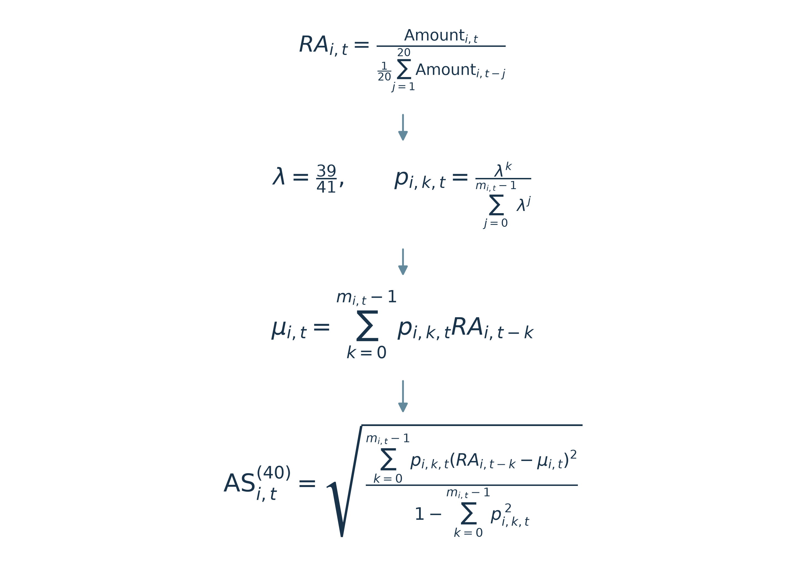
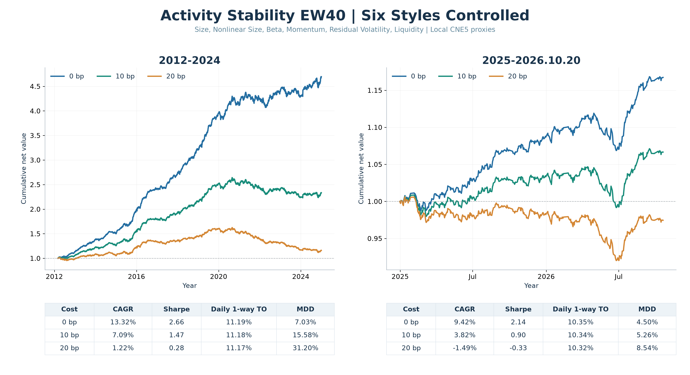
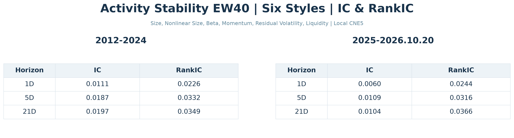
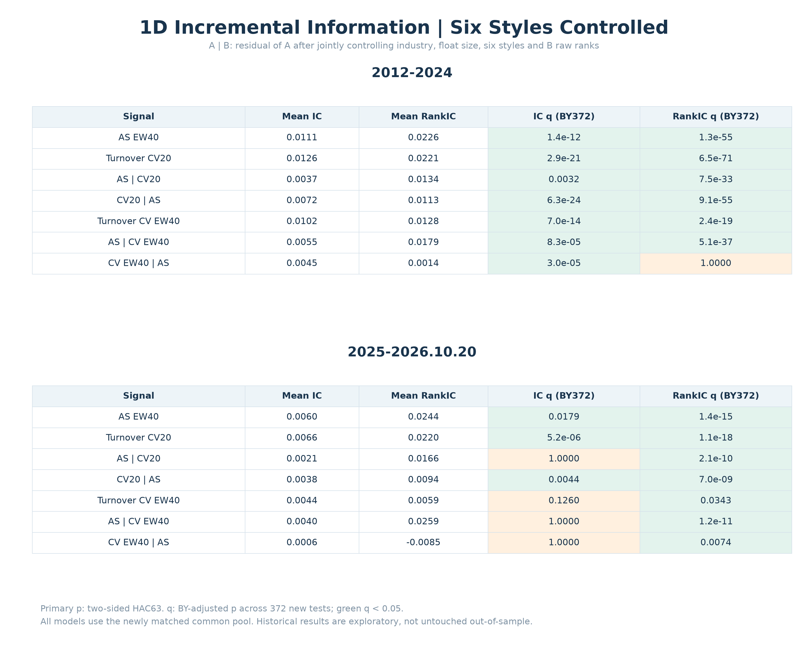

# Activity Stability EW40 · 成交稳态因子

**Exploratory China A-share research · relative trading activity · six-style controls · HAC/BY · Fama–MacBeth · turnover-CV increments**

[中文说明](README.zh-CN.md) · [Methodology](reports/methodology.md) · [All results and figures](reports/results.md) · [Incremental study / 中文](reports/incremental.zh-CN.md) · [Notebook](notebooks/research.ipynb) · [Data interface](data/README.md)

This project studies whether stocks with more stable **relative trading activity** contain information about subsequent returns. The raw feature is the EW40 standard deviation of today's traded amount relative to its preceding 20-session average. Its research direction is negative. It measures activity dispersion, not price volatility or stability around a fixed ratio of one.

**Evidence: some ranking information survives six local style controls and turnover-CV controls. Evidence for incremental linear-return prediction and net portfolio improvement is weaker.** This is neither a claim of a newly discovered anomaly nor a fully style-independent, deployable alpha.

## Formula

$$
RA_{i,t}=\frac{Amount_{i,t}}{\frac1{20}\sum_{j=1}^{20}Amount_{i,t-j}}
$$

$$
\lambda=39/41,\quad p_{i,k,t}=\frac{\lambda^k}{\sum_{j=0}^{m_{i,t}-1}\lambda^j},\quad \mu_{i,t}=\sum_{k=0}^{m_{i,t}-1}p_{i,k,t}RA_{i,t-k}
$$

$$
AS_{i,t}=\sqrt{\frac{\sum_{k=0}^{m_{i,t}-1}p_{i,k,t}(RA_{i,t-k}-\mu_{i,t})^2}{1-\sum_{k=0}^{m_{i,t}-1}p_{i,k,t}^2}}
$$

`m` is the continuous valid RA history, with at least 40 observations. Missing RA resets it. EW40 is a decay span using the full valid segment, **not a trailing 40-day truncation and not STD20 followed by EMA40**. The denominator excludes today. The variance uses a finite-weight correction; this does not establish unbiased estimation under serial dependence.

Processing: average cross-sectional ranks → ONE joint industry / log float-cap / selected-controls OLS → population-z residual → direction −1. Six controls add total-cap size, nonlinear size, beta, momentum, residual volatility and liquidity. They are **local public-method proxies, not official or complete Barra exposures**.



## Returns and transaction costs

Long/short linear signals target +100%/−100% NAV, rebalance daily, and execute t-close information at t+1 close; first holding return is t+1 to t+2. Actual positions can differ due to freezes and costs. Positions continue across 2025; charts only rebase NAV. Costs are charged on actual **bilateral** traded notional. CAGR uses 252 sessions; Sharpe uses rf=0 and sample SD. The 5D/21D labels are prediction horizons, not separately tested rebalancing schedules.

Six-style-controlled portfolios:

| period | cost_bps | annual_return_pct | sharpe | max_drawdown_pct | one_way_turnover_pct |
| --- | --- | --- | --- | --- | --- |
| research | 0 | 13.32 | 2.66 | 7.028 | 11.19 |
| later | 0 | 9.421 | 2.137 | 4.5 | 10.35 |
| research | 10 | 7.094 | 1.471 | 15.58 | 11.18 |
| later | 10 | 3.821 | 0.9013 | 5.258 | 10.34 |
| research | 20 | 1.215 | 0.2788 | 31.2 | 11.17 |
| later | 20 | -1.491 | -0.3307 | 8.537 | 10.32 |



At 20 bp, later-period CAGR is **−1.49%**. Cost sensitivity is material. Borrow, financing, impact, capacity and detailed limit-order behavior are not fully modeled.

## Prediction and significance

After six styles, 5D RankIC is **0.0332 / 0.0316** in the two windows and passes the original HAC63/BY552 test. Later 21D ordinary IC fails BY552. In six-controlled Fama–MacBeth regression, later 1D passes, **5D q≈0.063 fails**, and 21D fails. Statistical ranking evidence is not evidence of guaranteed net profit.



Original q values refer to 540 IC tests +12 FMB tests =552. The turnover-CV extension has its own **372-test family**, plus exploratory combined 924-test sensitivity. Never interchange these q columns. Neither family covers all prior historical factor mining. FMB is daily joint characteristic OLS followed by mean-coefficient inference, not IV/2SLS, causality or an independent dataset.

## Incremental information versus turnover variability

Fixed references: negative STD20(turnover)/MEAN20(turnover), and a negative EW40 weighted-STD/weighted-mean version; turnover is volume/float shares. After six styles, AS/CV20 correlations are about **0.63–0.64**. Later 1D residual RankIC is **0.0166**, BY372-significant, but AS's joint 1D coefficient has p≈0.246 and the residual 10bp book CAGR is **−5.27%**. Fixed 50/50 blends do not establish significant net-return improvement and do not outperform AS alone in the later window.



See the [complete incremental report](reports/incremental.zh-CN.md) for both CV references, both directions of residualization, all costs and all horizons.

## Robustness and limits

- Nine fixed neighbors: amount-reference window 15/20/25 × EW span30/40/50. No isolated point-estimate peak; stricter simultaneous 80%-retention tests pass the main RankIC maps, but later CAGR maps **do not fully pass**.
- Delay and exclusion checks preserve positive gross signals. Their grids/pools differ; use within-study matched comparisons, not cross-chart subtraction.
- All history through **2026-10-20 has already been inspected**, including 2025+. The later window is not untouched OOS. Actual main book history begins 2012-03-07 after universe/warmup constraints.
- EW40 emerged from historical estimator comparisons (ten jointly compared configurations). Direction was frozen on the earlier training window. The candidate did not achieve simultaneous IC and turnover improvement in both development windows; broader historical search is not globally corrected.
- Six controls omit fundamental styles including B/P, earnings yield, growth and leverage. Short-term reversal is not the same as the momentum control. Expanded controls and portfolio-return attribution are **future work**, not completed tests.
- Historical industry availability, financial-data PIT, source revisions, ST/delist terminal treatment, short availability, price limits and capacity are not fully certified.
- Economic explanations involving attention, order pressure or investor disagreement are hypotheses, not identified causal mechanisms.

## Run locally

```bash
python -m pip install -r requirements.txt
python -m pip install -e . --no-deps
python -m unittest discover -s tests -v
python scripts/audit_release.py
python scripts/render_cost_chart.py
python examples/make_demo.py
```

The reference code reproduces the **estimator**, one-date joint projection, HAC/BY inference and aggregate-ledger summaries. The release audit recomputes all 108 portfolio metrics, 216 IC statistics, 84 new FMB statistics and the original 552 / new 372 / combined 924 BY adjustments from released aggregates. It does **not** recreate the original stock-level universe or trading engine. Provider market panels, eligibility masks and holdings are not redistributed. A real empirical rerun requires those inputs and the execution specification in [methodology](reports/methodology.md). Synthetic demo results are not empirical results.

## Research lineage

- [Chordia, Subrahmanyam & Anshuman (2001), Trading activity and expected stock returns](https://research.iimb.ac.in/fac_pubs/1268/)
- [Barinov (2015), Why does higher variability of trading activity predict lower expected returns?](https://faculty.ucr.edu/~abarinov/Turnover%20Variability%20%28JBF%20R3%29.pdf)
- [Fama & MacBeth (1973)](https://doi.org/10.1086/260061)
- [Benjamini & Yekutieli (2001)](https://doi.org/10.1214/aos/1013699998)

Related work supplies context, not external validation of this exact formula. This repository is a research record, not a claim of investment readiness.
