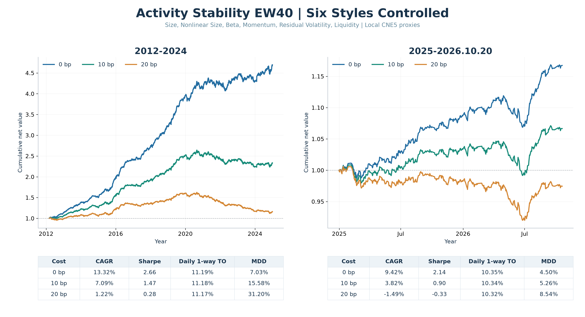

# 成交稳态因子 EW40

[English README](README.md) · [完整方法](reports/methodology.md) · [结果与图表](reports/results.md) · [换手率CV增量检验](reports/incremental.zh-CN.md)

研究范围：A股；源数据截至2026-10-20。主组合实际从2012-03-07开始。

**主要结论：成交稳定性信号在控制六项本地风格后仍保留部分排序信息，但不能据此认定为完全独立的新Alpha。与换手率变异系数比较后，剩余排序信息仍存在，新增线性收益与扣费组合增量证据较弱。**

## 定义与口径

当天成交额÷此前20日平均成交额，形成相对交易活跃度RA，再计算尺度40的指数加权标准差，固定负向：相对交易活动越稳定，信号越高。权重lambda=39/41，使用全部连续有效RA历史，至少40个才输出；缺失重置。它不是40日截断窗口，也不是先STD20再EMA40。

处理为横截面平均排名→行业、log流通市值及指定控制项的一次联合OLS→残差总体标准化→负向。六项风格为总市值、非线性市值、Beta、动量、残差波动率、流动性，是本地代理，不是官方完整Barra。行业和基础流通市值处理仍保留。

线性信号多空各100%、每日调仓；t收盘信号在t+1收盘成交，首次持有收益t+1到t+2。不可交易持仓冻结，失败预算不重新分配，2025年不重置持仓。0/10/20bp按实际双边成交额分别记账，日均单边换手=双边/2。5D/21D指预测标签，不是已经完成对应频率的独立交易回测。

## 基础版与六风格控制后的收益

| model | period | cost_bps | annual_return_pct | sharpe | max_drawdown_pct | one_way_turnover_pct |
| --- | --- | --- | --- | --- | --- | --- |
| base__AS | research | 0 | 22.6 | 3.558 | 4.997 | 10.35 |
| base__AS | later | 0 | 25.44 | 3.134 | 4.137 | 9.101 |
| base__AS | research | 10 | 16.36 | 2.655 | 8.126 | 10.34 |
| base__AS | later | 10 | 19.81 | 2.506 | 4.77 | 9.097 |
| base__AS | research | 20 | 10.44 | 1.749 | 11.9 | 10.34 |
| base__AS | later | 20 | 14.43 | 1.878 | 5.578 | 9.091 |
| six__AS | research | 0 | 13.32 | 2.66 | 7.028 | 11.19 |
| six__AS | later | 0 | 9.421 | 2.137 | 4.5 | 10.35 |
| six__AS | research | 10 | 7.094 | 1.471 | 15.58 | 11.18 |
| six__AS | later | 10 | 3.821 | 0.9013 | 5.258 | 10.34 |
| six__AS | research | 20 | 1.215 | 0.2788 | 31.2 | 11.17 |
| six__AS | later | 20 | -1.491 | -0.3307 | 8.537 | 10.32 |

六风格控制后，0bp年化为13.32%/9.42%；10bp为7.09%/3.82%；20bp为1.22%/−1.49%。信号包含风格成分，交易成本敏感。控制前后年化差不能直接当作可加的风格收益归因。

## 统计证据怎样读

六风格控制后5D RankIC为0.0332/0.0316，均通过原HAC63、BY552；后段21D普通IC未通过。后段六风格FMB中，1D通过BY552，5D的q约0.063、21D不通过。RankIC、普通IC、回归与净收益回答不同问题，不能用一项通过代替全部通过。

p检验IC均值或回归系数均值是否为零；q是指定检验族的BY调整p，不是因子无效的概率。原552项、新增372项、合并924项分开标注；没有覆盖整个历史挖掘过程。

## 相对换手率变异系数的增量

固定CV20=20日换手率样本标准差/均值，另加同尺度CVEW40，均负向，不额外择参。与CV20的六风格后相关性约0.63—0.64。额外控制CV20后，后段1D RankIC约0.0166且显著；但AS的后段联合回归p约0.246，残差组合10bp年化约−5.27%。固定组合改善CV基准的净收益未通过配对BY检验，且后段未超过AS单独。

## 稳健性、已有研究与局限

九组邻近参数的点估计未出现孤立尖峰；严格同时80%保留率检验下，主RankIC地图通过，后段CAGR地图未全部通过。延迟成交、剔除部分小市值和低成交额股票后仍有正向费前信息；这不等于容量和真实可交易性已经验证。

成交活动变异性已有学术研究，本项目不宣称首次提出新经济机制。EW40来自历史估计器比较，全部历史都已查看，2025以后不是完全未触碰样本外；参数局部校正不能消除更早的选择偏差。

当前六项控制缺少基本面价值、成长、杠杆等维度，也尚未完成本次讨论的新短期反转控制或完整组合收益归因。财务数据PIT、历史行业、退市终值、融券、涨跌停与容量仍有局限。

## 复现范围

仓库提供独立的因子数值代码、单截面处理、HAC/BY、统计审计、合成示例、研究图及汇总日序列。可重算已发布日序列的统计量；**不包含原始行情、逐股持仓、完整股票池和完整交易引擎，因此不是一键从行情重跑全部实证回测。** 具体命令见英文首页，输入约定见[data/README.md](data/README.md)。

旧PDF位于[reports/ew40_research_snapshot.pdf](reports/ew40_research_snapshot.pdf)，是换手率CV增量检验之前的报告快照；最新增量结论以本仓库增量报告为准。
