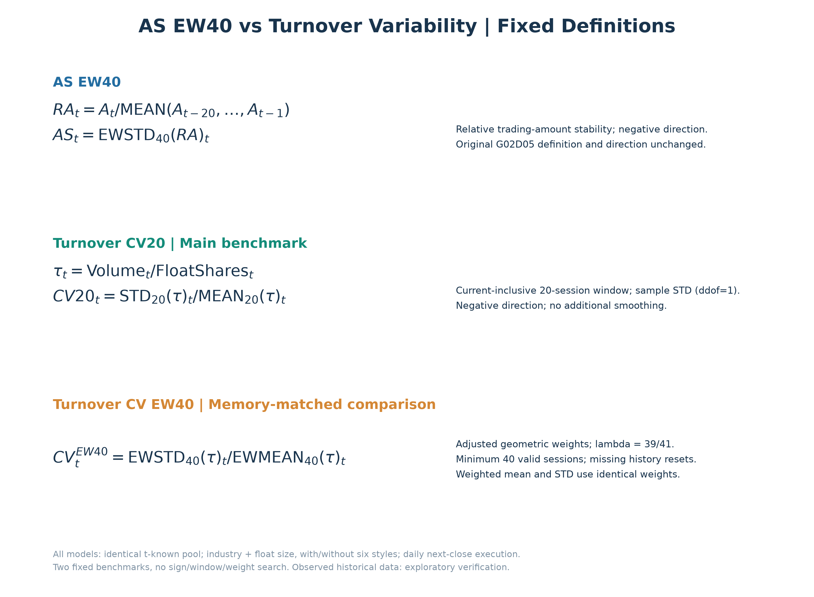
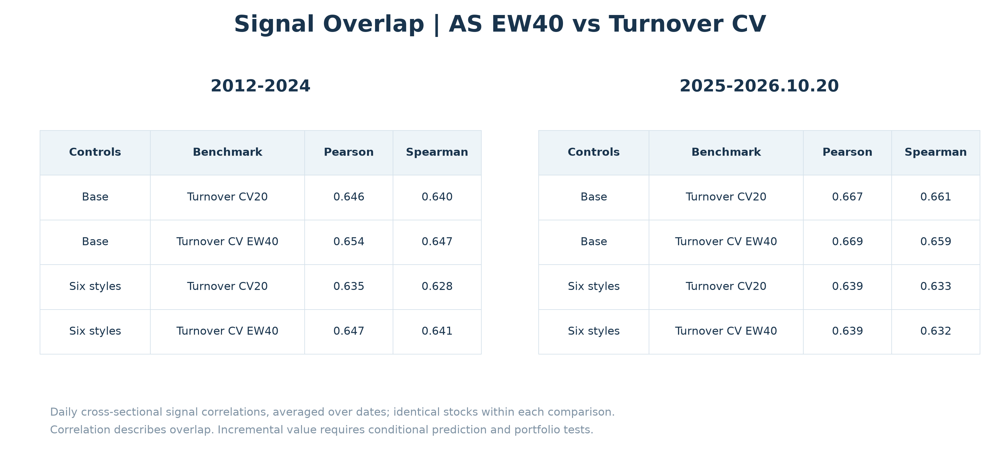
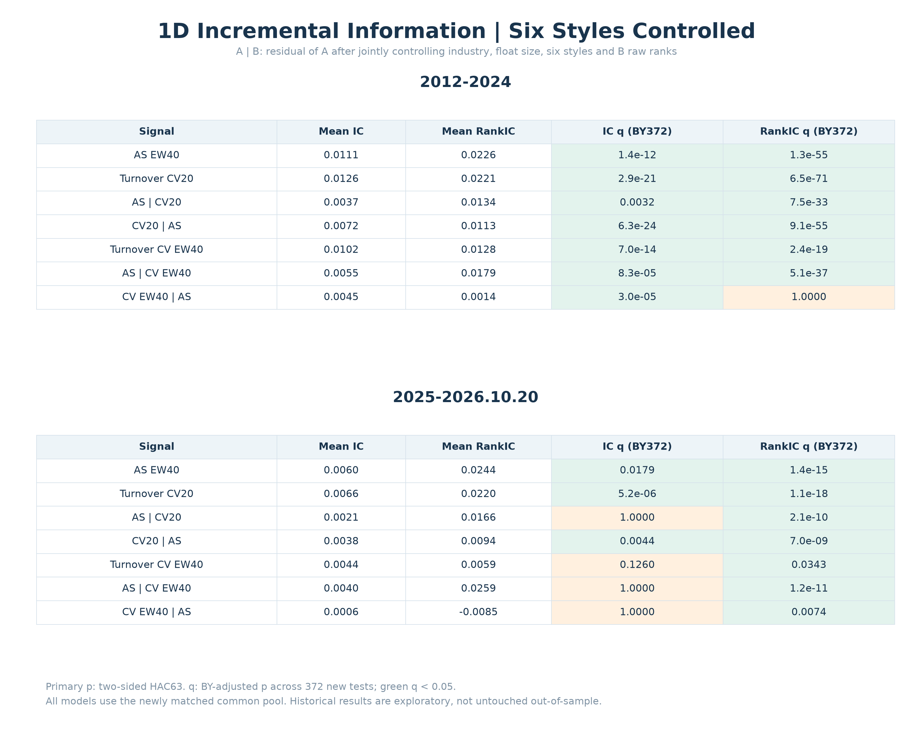
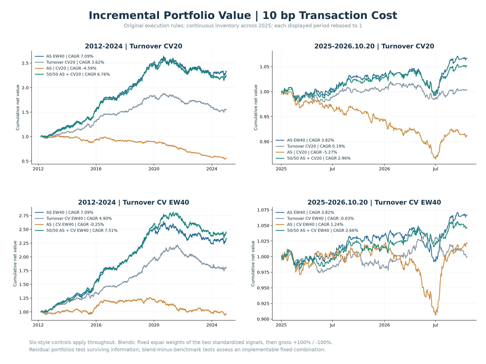
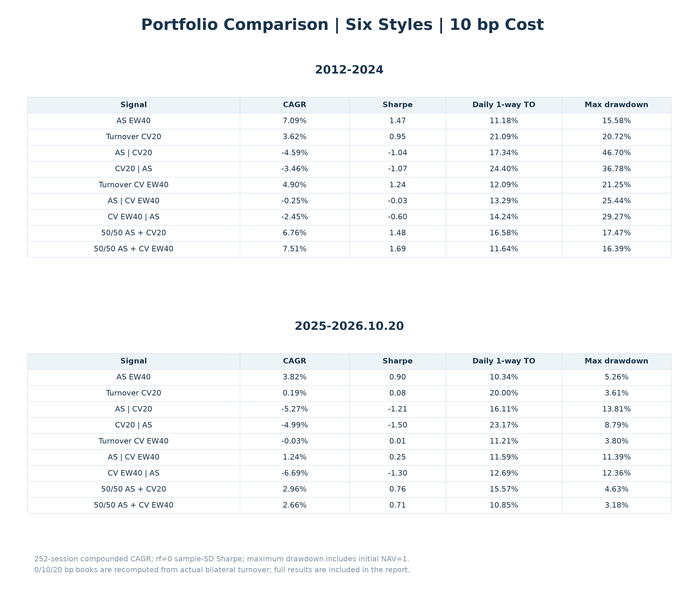
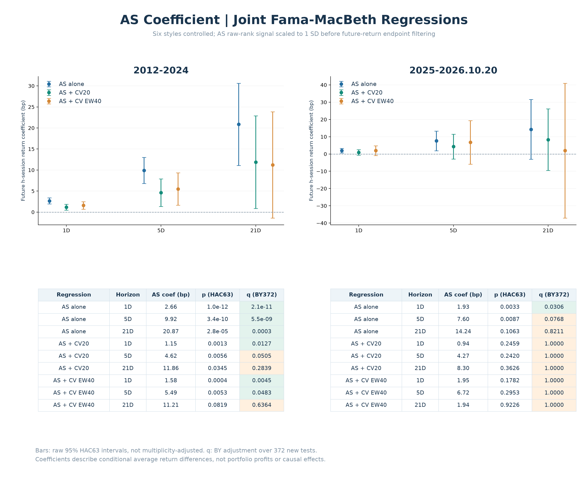

# 成交稳态EW40相对换手率变异系数的增量检验

本轮保持AS原公式、负向方向、原交易规则不变，比较固定CV20主基准与CVEW40尺度对照。用户确认此前没有固定的换手率CV版本，采用本轮明确约定的定义。全部历史已经查看，这是探索性增量研究，不是未触碰样本外验证。

**主要结论：存在剩余排序信息，但新增线性收益和扣费组合增量的证据不足。** 后段AS额外控制CV20或CVEW40后，1D RankIC仍为正且通过本轮校正；同一后段的普通IC与AS联合回归系数均未显著。固定50/50组合相对CV基准的10bp年化有所提高，但配对日收益改善未通过BY校正，后段年化也未超过AS单独。前段1D联合系数的证据更强，存在阶段差异。

RankIC关注排序关系，普通IC和回归还受收益幅度及截面尺度影响；不能因为RankIC通过，就把线性收益关系与扣费增量也称为通过。未通过也不等于已经证明不存在增量。

## 1. 先明确比较对象

- AS：当天成交额/此前20日均成交额，再计算EW40有限权重修正标准差，固定负向。
- CV20：换手率的20日样本标准差/同期20日均值，窗口包含当日，不加额外EMA，固定负向。
- CVEW40：换手率的EW40修正标准差/同权重加权均值；lambda=39/41，至少40个连续有效值，缺失重置，固定负向。
- 换手率直接使用源数据Volume/CirculatedShare；不使用成交额/市值代理，不将高于100%的换手截断。可观测零成交保留，缺失不前填。

两者都研究交易活动稳定性，但AS先除以逐日变化的历史成交额基准，CV则把换手率离散程度除以窗口内均值，因此不是代数等价。

## 2. 同池、同日期、同执行

先复现原十配置共同池和基础/六风格全部逐日1/5/21D IC，再只使用t日可知信息，与两个CV有效性取交集。所有18个组合使用同一股票池和共同起点，不要求未来存续。每个原始信号从横截面平均秩出发，在行业+log流通市值+指定控制的一次联合OLS中取残差并标准化，方向固定负向。六风格为本地公开CNE5代理，非官方完整Barra。

线性多空各100%，每日调仓，t收盘信号在t+1收盘执行，首次持有收益为t+1到t+2。冻结不可交易持仓，失败订单预算不重分配，2025不重置；0/10/20bp分别按实际双边成交额重算费用。年化252日复利，夏普rf=0样本标准差，回撤包含初始净值1。IC标签从次日收盘起算，分期末剔除跨期标签。

固定50/50组合使用两个已按同一控制集处理、标准化后的信号等权混合，再统一归一化多空端；没有用未来收益拟合组合权重。残差信号的净值与固定组合是不同问题，不能用残差年化直接代表加入旧策略后的新增利润。

交集股票日保留原共同池的100.000%。完整逐日覆盖见universe_coverage.csv；本轮同池AS已与原主图逐日复现一致；仍以本轮AS作为增量比较基准。

## 3. 信号重叠

| period | baseline | pearson | spearman | days |
| --- | --- | --- | --- | --- |
| research | CV20 | 0.6346 | 0.6276 | 3086 |
| later | CV20 | 0.6385 | 0.6326 | 433 |
| research | CVEW40 | 0.6471 | 0.6413 | 3086 |
| later | CVEW40 | 0.6387 | 0.6321 | 433 |

相关性是描述，不是独立性的判决。

## 4. 1D双向剩余信息

AS | CV表示控制六风格并额外控制CV原始秩；CV | AS反过来控制。所有控制在一次联合回归中完成。

| period | signal | IC | RankIC | q_IC | q_RankIC |
| --- | --- | --- | --- | --- | --- |
| research | AS EW40 | 0.0111 | 0.0226 | 1.4e-12 | 1.3e-55 |
| research | Turnover CV20 | 0.0126 | 0.0221 | 2.9e-21 | 6.5e-71 |
| research | AS \| CV20 | 0.0037 | 0.0134 | 0.0032 | 7.5e-33 |
| research | CV20 \| AS | 0.0072 | 0.0113 | 6.3e-24 | 9.1e-55 |
| research | Turnover CV EW40 | 0.0102 | 0.0128 | 7.0e-14 | 2.4e-19 |
| research | AS \| CV EW40 | 0.0055 | 0.0179 | 8.3e-05 | 5.1e-37 |
| research | CV EW40 \| AS | 0.0045 | 0.0014 | 3.0e-05 | 1.0000 |
| later | AS EW40 | 0.0060 | 0.0244 | 0.0179 | 1.4e-15 |
| later | Turnover CV20 | 0.0066 | 0.0220 | 5.2e-06 | 1.1e-18 |
| later | AS \| CV20 | 0.0021 | 0.0166 | 1.0000 | 2.1e-10 |
| later | CV20 \| AS | 0.0038 | 0.0094 | 0.0044 | 7.0e-09 |
| later | Turnover CV EW40 | 0.0044 | 0.0059 | 0.1260 | 0.0343 |
| later | AS \| CV EW40 | 0.0040 | 0.0259 | 1.0000 | 1.2e-11 |
| later | CV EW40 \| AS | 0.0006 | -0.0085 | 1.0000 | 0.0074 |

## 5. 直接对应后段的结果

与CV20比较：后段控制六风格并额外控制该CV后，AS的1D RankIC为0.016572（原同池AS为0.024361；比值68.0%，仅作描述，不能当作可加的收益归因），q372=2.05521e-10，q924=1.62683e-10。1D普通IC为0.002082。联合回归中AS的1D系数为0.942bp，p=0.245894，q372=1，q924=1。10bp成本下，CV单独年化0.19%，50/50组合为2.96%，差+2.76个百分点；配对日均收益变化+1.0879bp，q372=0.303132；AS残差组合年化-5.27%。同口径AS单独年化为3.82%，50/50组合相对AS单独变化-0.86个百分点，改善CV基准并不自动代表超过AS单独。

与CVEW40比较：后段控制六风格并额外控制该CV后，AS的1D RankIC为0.025909（原同池AS为0.024361；比值106.4%，仅作描述，不能当作可加的收益归因），q372=1.23174e-11，q924=9.45362e-12。1D普通IC为0.003993。联合回归中AS的1D系数为1.946bp，p=0.178205，q372=1，q924=1。10bp成本下，CV单独年化-0.03%，50/50组合为2.66%，差+2.69个百分点；配对日均收益变化+1.0528bp，q372=1；AS残差组合年化1.24%。同口径AS单独年化为3.82%，50/50组合相对AS单独变化-1.16个百分点，改善CV基准并不自动代表超过AS单独。

## 6. 联合两步回归：AS的条件系数

每天将负向原始秩信号按t日完整共同池标准化，在同一回归中放入行业、log流通市值、六风格以及AS/CV；然后对日系数均值做HAC。系数单位为每1个标准差原始秩信号对应未来h日累计收益差bp，不是策略收益、因果效应或工具变量2SLS。

| period | regression | horizon | AS_coefficient_bp | p | q_BY372 | q_BY924 |
| --- | --- | --- | --- | --- | --- | --- |
| research | AS | 1 | 2.662 | 1.0e-12 | 2.1e-11 | 1.6e-11 |
| research | AS | 5 | 9.916 | 3.4e-10 | 5.5e-09 | 4.5e-09 |
| research | AS | 21 | 20.867 | 2.8e-05 | 0.0003 | 0.0003 |
| research | AS_CV20 | 1 | 1.153 | 0.0013 | 0.0127 | 0.0120 |
| research | AS_CV20 | 5 | 4.621 | 0.0056 | 0.0505 | 0.0482 |
| research | AS_CV20 | 21 | 11.862 | 0.0345 | 0.2839 | 0.2844 |
| research | AS_CVEW40 | 1 | 1.582 | 0.0004 | 0.0045 | 0.0042 |
| research | AS_CVEW40 | 5 | 5.489 | 0.0053 | 0.0483 | 0.0460 |
| research | AS_CVEW40 | 21 | 11.212 | 0.0819 | 0.6364 | 0.6524 |
| later | AS | 1 | 1.928 | 0.0033 | 0.0306 | 0.0289 |
| later | AS | 5 | 7.600 | 0.0087 | 0.0768 | 0.0745 |
| later | AS | 21 | 14.240 | 0.1063 | 0.8211 | 0.8432 |
| later | AS_CV20 | 1 | 0.942 | 0.2459 | 1.0000 | 1.0000 |
| later | AS_CV20 | 5 | 4.270 | 0.2420 | 1.0000 | 1.0000 |
| later | AS_CV20 | 21 | 8.295 | 0.3626 | 1.0000 | 1.0000 |
| later | AS_CVEW40 | 1 | 1.946 | 0.1782 | 1.0000 | 1.0000 |
| later | AS_CVEW40 | 5 | 6.720 | 0.2953 | 1.0000 | 1.0000 |
| later | AS_CVEW40 | 21 | 1.936 | 0.9226 | 1.0000 | 1.0000 |

## 7. 六风格控制后全部成本的组合指标

| model | period | cost_bps | annual_return_pct | sharpe | max_drawdown_pct | one_way_turnover_pct |
| --- | --- | --- | --- | --- | --- | --- |
| six__AS | research | 0 | 13.3202 | 2.6602 | 7.0284 | 11.1898 |
| six__AS | later | 0 | 9.4214 | 2.1371 | 4.5004 | 10.3505 |
| six__AS | research | 10 | 7.094 | 1.4712 | 15.58 | 11.1819 |
| six__AS | later | 10 | 3.8212 | 0.9013 | 5.258 | 10.3371 |
| six__AS | research | 20 | 1.2152 | 0.2788 | 31.1951 | 11.1733 |
| six__AS | later | 20 | -1.4913 | -0.3307 | 8.5367 | 10.3195 |
| six__CV20 | research | 0 | 15.2709 | 3.7437 | 4.45 | 21.1179 |
| six__CV20 | later | 0 | 10.8728 | 3.1181 | 1.9667 | 20.0474 |
| six__CV20 | research | 10 | 3.615 | 0.9518 | 20.7196 | 21.0926 |
| six__CV20 | later | 10 | 0.1947 | 0.075 | 3.6051 | 20.0049 |
| six__CV20 | research | 20 | -6.845 | -1.8429 | 59.3064 | 21.0612 |
| six__CV20 | later | 20 | -9.4412 | -2.9717 | 15.7393 | 19.9262 |
| six__CVEW40 | research | 0 | 11.5132 | 2.7959 | 8.2705 | 12.1044 |
| six__CVEW40 | later | 0 | 5.8321 | 1.4734 | 2.7571 | 11.2309 |
| six__CVEW40 | research | 10 | 4.8977 | 1.24 | 21.2482 | 12.0942 |
| six__CVEW40 | later | 10 | -0.0337 | 0.0107 | 3.7986 | 11.2105 |
| six__CVEW40 | research | 20 | -1.3183 | -0.3192 | 34.858 | 12.0825 |
| six__CVEW40 | later | 20 | -5.5738 | -1.4653 | 10.2947 | 11.1812 |
| six__AS_res_CV20 | research | 0 | 4.1407 | 0.9409 | 14.0024 | 17.364 |
| six__AS_res_CV20 | later | 0 | 2.8478 | 0.663 | 5.2536 | 16.159 |
| six__AS_res_CV20 | research | 10 | -4.5912 | -1.0419 | 46.7011 | 17.3421 |
| six__AS_res_CV20 | later | 10 | -5.2698 | -1.2078 | 13.8057 | 16.1053 |
| six__AS_res_CV20 | research | 20 | -12.576 | -3.0127 | 81.5682 | 17.3151 |
| six__AS_res_CV20 | later | 20 | -12.7329 | -3.0397 | 23.0831 | 16.0167 |
| six__AS_res_CVEW40 | research | 0 | 6.6691 | 1.3243 | 10.6196 | 13.3052 |
| six__AS_res_CVEW40 | later | 0 | 7.3644 | 1.2914 | 9.0827 | 11.6048 |
| six__AS_res_CVEW40 | research | 10 | -0.2499 | -0.0255 | 25.4354 | 13.2933 |
| six__AS_res_CVEW40 | later | 10 | 1.2447 | 0.2479 | 11.3923 | 11.5852 |
| six__AS_res_CVEW40 | research | 20 | -6.7108 | -1.3716 | 58.9746 | 13.2805 |
| six__AS_res_CVEW40 | later | 20 | -4.5111 | -0.7923 | 17.1396 | 11.5596 |
| six__CV20_res_AS | research | 0 | 9.1952 | 2.7181 | 4.8084 | 24.4305 |
| six__CV20_res_AS | later | 0 | 6.7788 | 1.9671 | 2.7253 | 23.243 |
| six__CV20_res_AS | research | 10 | -3.4597 | -1.0658 | 36.7796 | 24.3982 |
| six__CV20_res_AS | later | 10 | -4.986 | -1.4988 | 8.7862 | 23.1736 |
| six__CV20_res_AS | research | 20 | -14.627 | -4.8274 | 85.8649 | 24.3594 |
| six__CV20_res_AS | later | 20 | -15.3924 | -4.9396 | 25.1373 | 23.0542 |
| six__CVEW40_res_AS | research | 0 | 4.8312 | 1.1942 | 13.4597 | 14.2568 |
| six__CVEW40_res_AS | later | 0 | -0.4847 | -0.0662 | 9.898 | 12.7247 |
| six__CVEW40_res_AS | research | 10 | -2.4484 | -0.5975 | 29.2672 | 14.2398 |
| six__CVEW40_res_AS | later | 10 | -6.693 | -1.2974 | 12.3598 | 12.6883 |
| six__CVEW40_res_AS | research | 20 | -9.2113 | -2.3852 | 69.7382 | 14.2194 |
| six__CVEW40_res_AS | later | 20 | -12.5057 | -2.5469 | 21.2736 | 12.6317 |
| six__blend_AS_CV20 | research | 0 | 16.0907 | 3.3437 | 4.122 | 16.5923 |
| six__blend_AS_CV20 | later | 0 | 11.4217 | 2.7778 | 3.4226 | 15.599 |
| six__blend_AS_CV20 | research | 10 | 6.7593 | 1.4814 | 17.474 | 16.576 |
| six__blend_AS_CV20 | later | 10 | 2.9572 | 0.7622 | 4.6321 | 15.5728 |
| six__blend_AS_CV20 | research | 20 | -1.8109 | -0.3854 | 40.7288 | 16.557 |
| six__blend_AS_CV20 | later | 20 | -4.8621 | -1.2504 | 11.3962 | 15.5309 |
| six__blend_AS_CVEW40 | research | 0 | 14.0281 | 3.0329 | 6.268 | 11.6517 |
| six__blend_AS_CVEW40 | later | 0 | 8.482 | 2.1749 | 2.4326 | 10.8678 |
| six__blend_AS_CVEW40 | research | 10 | 7.5086 | 1.6857 | 16.392 | 11.6432 |
| six__blend_AS_CVEW40 | later | 10 | 2.6581 | 0.7143 | 3.1761 | 10.8522 |
| six__blend_AS_CVEW40 | research | 20 | 1.3674 | 0.334 | 31.5617 | 11.6336 |
| six__blend_AS_CVEW40 | later | 20 | -2.8534 | -0.7496 | 6.9495 | 10.8304 |

## 8. 固定组合相对CV基准的改变

CAGR变化是复利年化的描述差；显著性另对共同日期日收益差做HAC和区块bootstrap，不能直接把年化差当作t检验的观测。回撤变化为负代表最大回撤减小。

| baseline | period | cost_bps | CAGR_change_pp | Sharpe_change | MDD_change_pp | one_way_TO_change_pp |
| --- | --- | --- | --- | --- | --- | --- |
| CV20 | research | 0 | 0.8197 | -0.4 | -0.3279 | -4.5257 |
| CV20 | research | 10 | 3.1443 | 0.5296 | -3.2456 | -4.5165 |
| CV20 | research | 20 | 5.0341 | 1.4575 | -18.5776 | -4.5042 |
| CV20 | later | 0 | 0.5489 | -0.3403 | 1.4559 | -4.4483 |
| CV20 | later | 10 | 2.7625 | 0.6872 | 1.027 | -4.4321 |
| CV20 | later | 20 | 4.5791 | 1.7213 | -4.3431 | -4.3953 |
| CVEW40 | research | 0 | 2.5149 | 0.237 | -2.0024 | -0.4527 |
| CVEW40 | research | 10 | 2.6108 | 0.4457 | -4.8562 | -0.451 |
| CVEW40 | research | 20 | 2.6857 | 0.6532 | -3.2963 | -0.4488 |
| CVEW40 | later | 0 | 2.6499 | 0.7015 | -0.3245 | -0.363 |
| CVEW40 | later | 10 | 2.6918 | 0.7035 | -0.6225 | -0.3582 |
| CVEW40 | later | 20 | 2.7204 | 0.7157 | -3.3451 | -0.3507 |

## 9. p、q与检验范围

主p为双侧HAC63渐近正态检验，IC/RankIC检验均值为0，FMB检验平均系数为0，配对检验检查组合减基准的平均变化为0。HAC21/126与63日循环区块bootstrap为敏感性，bootstrap1999次，不报告为零的重抽样p。

本轮新族固定372项：18信号×2区间×3期限×2类IC=216；FMB共84项；等权组合相对CV的配对IC变化48项；配对日收益变化24项。q为BY调整p，非每个因子无效的概率。另给旧552+新372合并924项的敏感性，避免混用之前图中的q552。后加检验不会把旧结果自动改成新q。不同族的q不保证单调更保守，不按显著与否选择范围。

所有均值的原始95%置信区间没有多重校正；最终显著性以明确列名的调整p判断。全历史矿挖掘次数不明，372和924都不是全项目全局校正。已看历史、PIT、退市终值、融券可得性、涨跌停和容量假设仍是限制。

## 10. 怎样评价增量

- AS | CV仍有显著的正向剩余信息，只支持相对于这个CV和指定控制项存在统计增量。
- 固定组合在扣费后提高收益/风险表现，才进一步支持实用组合价值；描述上改善但配对检验未过，需承认不确定性。
- 如果新旧信号相似、控制后衰减明显，则更接近同一稳定性主题的不同实现；这不自动意味着没有成本或换手改进价值。
- 两种CV、前后区间和正负结果全部保留，不以其中最好的一项宣称独立alpha。

## 图像

## 参考

[Chordia, Subrahmanyam & Anshuman (2001)](https://www.sciencedirect.com/science/article/abs/pii/S0304405X00000805)：交易活动变异性研究，非本地结果复现；[BY (2001)](https://doi.org/10.1214/aos/1013699998)。
